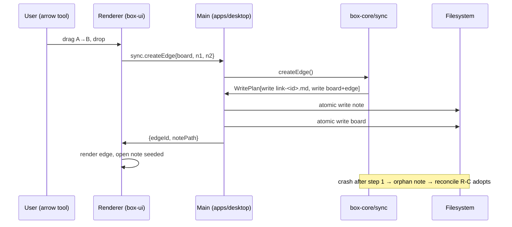
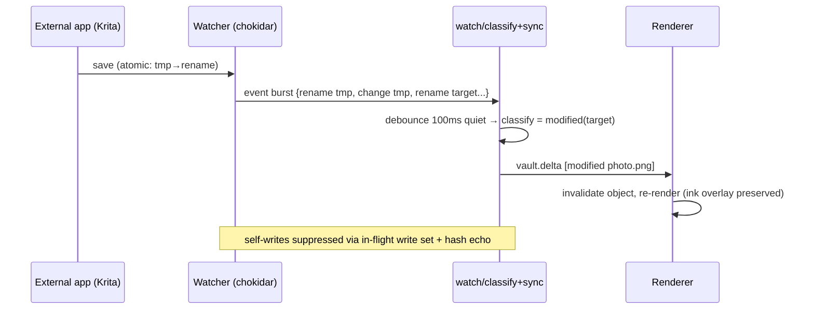

# ARCHITECTURE.md - System Design, Package Contracts, Salvage Map

|             |                                                                                                                          |
| ----------- | ------------------------------------------------------------------------------------------------------------------------ |
| **Status**  | Binding contract per package. Where this spec is more specific than the PRD, this spec wins; where silent, the PRD wins. |
| **Version** | 0.2 - 2026-10-12                                                                                                         |

## 0. Conventions that apply everywhere

- Repo root: `C:\Users\richk\CascadeProjects\the-box`. npm workspaces;
  dependencies pinned exactly at the root. Never `npm install` inside a task.
- TypeScript: ESM (`"type": "module"`), `NodeNext` resolution, `strict`.
  Import workspace packages by name (`@box/core`). Inside a package use
  relative imports with `.js` extensions.
- Tests: Vitest in `tests/**/*.test.ts` per package. Unit tests never need
  Electron, a GPU, Von, Ollama, or network. Anything needing Chrome or an
  external app is an integration test and must skip cleanly with a logged
  reason when the tool is missing.
- Files UTF-8, LF endings. Plain human prose in docs and comments.
  **No em dashes** outside the `docs/plans/` exemption.
- Windows first: `path` (not string concat), `spawn` with `shell: false`,
  `windowsHide: true`, resolve Node CLI entry points to `.js` + `process.execPath`.
- No secrets in repo, fixtures, logs, or workspace files.
- Deleting user data means recoverable state (Recycle Bin), never hard delete.
- `box-core` never imports Electron, never opens a socket, never touches the
  network. All I/O goes through adapter interfaces (§4).

## 1. Shape

```
┌──────────────────────────────────────────────────────────────────┐
│ apps/desktop           Electron 44 (Node 24.18.1 embedded)        │
│  main:     watcher impl, atomic writes, openPath, trashItem, prefs │
│  renderer: hosts box-ui; state via Zustand                         │
├──────────────────────────────────────────────────────────────────┤
│ packages/box-ui        React canvas + object renderers + ink       │
├──────────────────────────────────────────────────────────────────┤
│ packages/box-core      model, sync engine, vault iface, index,     │
│                        decisions client - pure TS, headless        │
├──────────────────────────────────────────────────────────────────┤
│ packages/box-mcp       optional MCP server (Stage 4)               │
└──────────────────────────────────────────────────────────────────┘
   optional, localhost only, core unaffected if all offline:
   Von :8770 (decisions)  Winnow :47311 (prune)  Ollama :11434
```

Dependency arrows point down only. `box-ui` knows `box-core`'s model types,
not its file I/O. `apps/desktop` adapts platform APIs to `box-core`
interfaces. `box-mcp` calls `box-core` like any client.

## 2. Verified facts (probed 2026-10-12, this machine)

| fact                                                                                                                                                                                                                                                                                              | source                             |
| ------------------------------------------------------------------------------------------------------------------------------------------------------------------------------------------------------------------------------------------------------------------------------------------------- | ---------------------------------- |
| Electron 44.0.0 embeds Node **24.18.1** (44.7.0 → 24.21.0); `node:sqlite` flag-free since Node 22.13, RC since 24.15 → available in Electron main                                                                                                                                                 | releases.electronjs.org            |
| `fs.watch` on Windows: emits `rename`/`change` only; deletes and renames both arrive as `rename`; duplicate `change` events normal; atomic saves interleave temp+target events                                                                                                                    | probe R-2 output (DATA-MODEL §5.1) |
| Obsidian tolerates **and preserves** unknown keys in `.canvas` by design: every node/edge carries `unknownData={}`, spread first on `getData()` then overridden by known keys (T-1, `obsidian.asar` app.js read 2026-10-12); plugin ecosystem corroborates                                        | `obsidian.asar` + `main.js`        |
| Von wire API: `POST 127.0.0.1:8770/v1/systemone`, body `{state, questions:{<n>:{type:noul\|choice\|score, instructions, criteria}}}` → `{answers:{<n>:{noul:<0..1>}}}`; env override `TYPESAFE_API_URL`. **Daemon offline at probe time - live-response/latency probe is a pending runbook task** | `jev-mcp/server.py:20-89`          |
| perfect-freehand 1.2.3 (MIT): `getStroke(points, StrokeOptions) -> Vec2[]` polygon outline; `simulatePressure` covers no-stylus input                                                                                                                                                             | `reference/perfect-freehand/src`   |
| tldraw SDK requires a license key for production (key-enforced, watermark on hobby tier)                                                                                                                                                                                                          | tldraw.dev/community/license       |

## 3. Package contracts

### 3.1 `@box/core` - the product

**Owns:** the workspace model, all file formats, the sync engine, the derived
index, the decisions client. The only package allowed to _specify_ file
content; it never performs I/O itself.

| submodule    | exports (planned surface)                                                                                                                                                                                                                                 | must not                                                                      |
| ------------ | --------------------------------------------------------------------------------------------------------------------------------------------------------------------------------------------------------------------------------------------------------- | ----------------------------------------------------------------------------- |
| `model/`     | `Workspace`, `Board`, `CanvasNode` (text/file/link/group union), `CanvasEdge`, `LinkNote`, `InkSidecar`; `parseBoard()`, `serializeBoard()`, `parseLinkNote()`, `serializeLinkNote()`, `parseInkSvg()`, `serializeInkSvg()`, `newEdgeId()`, `newNodeId()` | no I/O, no Date.now/Math.random in serialization paths (deterministic output) |
| `sync/`      | `createEdge(board, from, to) → WritePlan`, `deleteEdge(edgeId) → WritePlan`, `reconcile(scan) → ReconcileReport`, `detectRename(deleted, created, hasher) → RenameMap` - implements DATA-MODEL §6 rules R-A..R-G                                          | never writes directly; emits `WritePlan` step lists the platform executes     |
| `vault/`     | `interface IVault { read(), writeAtomic(), trash(), scan() }`, `WritePlan { steps: WriteStep[] }`                                                                                                                                                         | platform-agnostic; no fs imports                                              |
| `watch/`     | `classifyEvents(events, prevState) → Delta[]`, `debounce(config)` - encodes DATA-MODEL §5.2 rules                                                                                                                                                         | pure; timing injected                                                         |
| `index/`     | `Index` over node:sqlite: `fileNodes`, `edgesByNote`, `noteByEdge`, `fts` tables; `rebuild(scan)`                                                                                                                                                         | schema is a cache; no queries required to be correct for truth                |
| `decisions/` | `interface IDecisionClient`, `VonClient(url)`, `decide(question) → {pick, p, confidence}`, feature gates                                                                                                                                                  | fails silent-offline by design; never blocks sync paths                       |

**Invariant:** `box-core` runs `node test/` headless. If a file in it imports
`electron`, `fs`, `net`, or `http`, the build fails (lint rule).

### 3.2 `@box/ui` - the surface

**Owns:** rendering and interaction. Reads model objects; mutates only through
`box-core` calls via the IPC bridge (never imports IVault impls).

| submodule        | contents                                                                                                                                                         |
| ---------------- | ---------------------------------------------------------------------------------------------------------------------------------------------------------------- |
| `canvas/`        | camera (pan/zoom, `screenToWorld`/`worldToScreen`, zoomToFit - ported from CanvasMCPClient `canvasSlice`), node layer, edge layer, marquee selection, tool state |
| `objects/`       | `ImageObject`, `VideoObject` (HTML5, lazy-mount on viewport entry), `AudioObject`, `MarkdownCard`                                                                |
| `ink/`           | stroke capture → `getStroke` → outline → `.ink.svg` serialization hooks                                                                                          |
| `box-panel/`     | unplaced-file list, drag-to-place                                                                                                                                |
| `editor/`        | CodeMirror 6 link-note editor (frontmatter-aware: required-key highlight, `box-edge` read-only)                                                                  |
| `problem-items/` | reconcile warnings, malformed files, broken edges - a list, never silent                                                                                         |

### 3.3 `apps/desktop` - the platform

**Main process** adapts OS APIs to `box-core` interfaces:

| adapter     | implements        | backed by                                                    |
| ----------- | ----------------- | ------------------------------------------------------------ |
| `FsVault`   | `IVault`          | `fs/promises`, temp+rename atomic writes, `sha256` streaming |
| `Watcher`   | event source      | `chokidar` 5 → `watch/classifyEvents`                        |
| `Recycler`  | `IRecycler`       | `shell.trashItem`                                            |
| `Opener`    | `IOpener`         | `shell.openPath` + per-type prefs from `.box/settings.json`  |
| `Decisions` | `IDecisionClient` | `fetch` → Von `:8770` (offline → no-op)                      |

**IPC contract** (renderer ↔ main; payloads are model types, never paths
invented in renderer):

| channel                   | direction | payload                     | returns / errors                          |
| ------------------------- | --------- | --------------------------- | ----------------------------------------- |
| `workspace.open`          | r→m       | `{root: PathRel}`           | `WorkspaceScan` / `ERR_WORKSPACE_INVALID` |
| `board.get`               | r→m       | `{board: PathRel}`          | `Board`                                   |
| `sync.createEdge`         | r→m       | `{board, fromNode, toNode}` | `{edgeId, notePath}` / `ERR_NODE_MISSING` |
| `sync.deleteEdge`         | r→m       | `{edgeId}`                  | `ok` / `ERR_EDGE_MISSING`                 |
| `note.read`, `note.write` | r→m       | `{path}`                    | `LinkNote` / `ERR_NOTE_MALFORMED`         |
| `vault.delta`             | m→r       | `Delta[]`                   | push: refresh hints                       |
| `problem.list`            | r→m       | -                           | `ProblemItem[]`                           |
| `opener.with`             | r→m       | `{file, appId?}`            | `ok` / `ERR_NO_APP`                       |

**Renderer:** React 19 + Zustand 5; mounts `box-ui`. No `fs` access; all
state arrives via IPC payloads.

### 3.4 `@box/mcp` (Stage 4)

Read-mostly MCP server exposing `board.read`, `board.list-objects`,
`note.read`, `note.write` (through `box-core` - invariants hold for agents),
`search.query`, `box.unplaced`, `problem.list`. Contract format follows
`rea/docs/mcp-contracts.md` generated-catalog style (R-7c).

## 4. Canonical flows





## 5. Concurrency model

- **Single writer:** all file mutations originate in `box-core` `WritePlan`s
  executed serially by `apps/desktop`. No second writer exists in-process.
- **External writers** are facts of life (that's the product). They arrive as
  watcher deltas; reconcile converges state - same rules for external and
  internal causes.
- **Ordering:** classify → reconcile plan → execute → emit deltas. Reconcile
  runs are not reentrant; a new trigger during a run queues one follow-up.
- **Locks:** none across processes. Atomic writes + reconcile make races
  converge; last-writer-wins is per-file only.

## 6. Error taxonomy

| class             | examples                                 | surfacing                                 |
| ----------------- | ---------------------------------------- | ----------------------------------------- |
| `ERR_MALFORMED_*` | bad board JSON, bad frontmatter, bad ink | problem-items panel; never thrown at user |
| `ERR_MISSING_*`   | endpoint file gone, note gone            | broken-render state; recoverable per §I-7 |
| `ERR_IO_*`        | permission, locked file                  | toast + retry affordance; logged          |
| `ERR_WORKSPACE_*` | not a folder, unreadable                 | open dialog error                         |
| `ERR_DECISION_*`  | Von offline, timeout                     | silent no-op (features hide)              |

No silent failure: every anomaly lands in `problem-items` or the reconcile
log. User data is never auto-deleted (tombstone completion is logged).

## 7. Performance budgets

| operation                                | target                     | measured via             |
| ---------------------------------------- | -------------------------- | ------------------------ |
| open workspace (5k files, warm index)    | ≤5s to interactive         | e2e fixture clock        |
| draw edge → note + edge visible          | ≤300ms                     | e2e assertion            |
| external save → object refresh           | ≤1s (incl. 100ms debounce) | watcher integration test |
| pan/zoom, 500 objects                    | ≥30fps                     | frame timing probe       |
| reconcile on open (5k files, cold index) | ≤15s, resumable            | logged timings           |

## 8. Salvage map (donor → target; R-6 verified inventory)

| take                                                                                                                                                                          | from                                    | into                       | disposition                                                        |
| ----------------------------------------------------------------------------------------------------------------------------------------------------------------------------- | --------------------------------------- | -------------------------- | ------------------------------------------------------------------ |
| `Canvas`, `TextNode`, `FileNode`, `LinkNode`, `GroupNode`, `CanvasEdge` models                                                                                                | `obsidian-master-control-mcp/canvas.py` | `box-core/model`           | **port** - union types → TS discriminated unions                   |
| `parse_canvas_json`, `serialize_canvas`                                                                                                                                       | canvas.py:452-477                       | `box-core/model`           | **port** - add box-\* field handling + forward tolerance           |
| `generate_id` (uuid4().hex[:16])                                                                                                                                              | canvas.py:447                           | `box-core/model/newEdgeId` | **port** - `crypto.randomUUID`                                     |
| `detect_cycles`, `count_connected_components`, `get_node_connections`, `get_neighbors`, `calculate_bounding_box`, `get_nodes_in_group`, `node_in_bounds`, `get_node_preview`  | canvas.py helpers                       | `box-core/index` + `sync`  | **port**                                                           |
| node/edge CRUD + `batch_canvas_update` (ordered: del edges → del nodes(+edges) → add nodes w/ temp-id map → update nodes → add edges → update edges, per-op error collection) | `canvas_operations.py`                  | `box-core/sync`            | **adapt** - Python→TS; wrap each batch in WritePlan                |
| `canvas_overview`, `search_canvas_nodes` (type/regex/bounds/group filters), `get_canvas_subgraph` (depth expansion, internal/external edge flags)                             | `canvas_operations.py`                  | `box-core/index`           | **port** - query surface for UI + box-mcp                          |
| camera math: zoom clamp 0.1-5, `zoomToFit`, `panBy`, `screenToWorld`/`worldToScreen`, selectionBox, cursor states                                                             | `CanvasMCPClient/store/canvasSlice.ts`  | `box-ui/canvas`            | **port** - Redux actions → Zustand/store fns                       |
| `ConnectionVisualization`, `CanvasGrid`, `ZoomControls`                                                                                                                       | CanvasMCPClient components              | `box-ui/canvas`            | **adapt** - restyle to our model                                   |
| `UniversalWidgetEngine`                                                                                                                                                       | CanvasMCPClient                         | -                          | **skip** - its data model (SQLite widgets) is what we're replacing |
| `getStroke`, `getStrokePoints`, `getStrokeOutlinePoints`, `simulatePressure`                                                                                                  | `reference/perfect-freehand`            | `box-ui/ink`               | **depend** - MIT package, pinned 1.2.3                             |
| Project-core doctrine (folder-as-truth, atomic writes, manifest, deterministic contracts, e2e-to-file rig)                                                                    | `ResonanceStudio`                       | conventions                | **adopt patterns** - no code import                                |

Provenance rule: every ported/adapted file gets a header comment
`// Adapted from <path> (<license>): <what>; left out: <what>` and a row in
`THIRD_PARTY_NOTICES.md`.
